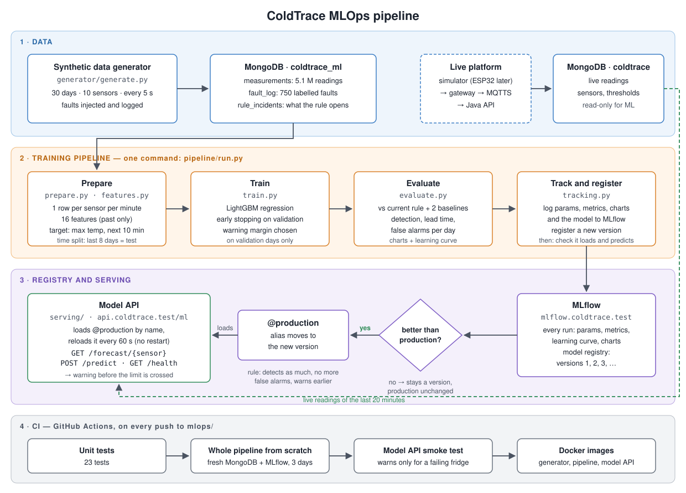

# ColdTrace : Supervision de la chaîne du froid

Projet **Cloud of Things** - École Supérieure des Communications de Tunis (Sup'Com)
Année universitaire 2026-2027

**Réalisé par :** Khalil Hedhili, Oussema Kard, Yessine Abdedayem
**Encadré par :** Dr. Ing. Mohamed-Bécha Kaâniche

## Présentation

ColdTrace est une solution Cloud of Things de supervision de la chaîne du froid
(entrepôts, chambres froides, transport frigorifique). Des capteurs connectés
mesurent la température, l'humidité et l'ouverture des portes. Une passerelle IoT
transmet les mesures au cloud, qui les stocke, les analyse et déclenche des alertes
en temps réel.

Deux applications clientes sont prévues :
- **front-office** : PWA installable avec le tableau de bord existant, historique récent, acquittement et coque hors ligne ;
- **back-office** : future PWA de gestion des capteurs, des sites, des seuils et des utilisateurs.

## Technologies

**Un seul WildFly 42** sert tout ColdTrace, avec un hôte virtuel par nom, configuré par les scripts du cours
(`default-host.cli`, `add-host.cli`, `add-api.cli`) et un fichier `.properties` par environnement
([middleware/wildfly](middleware/wildfly/README.md)) :

| Adresse | Contenu |
|---|---|
| https://coldtrace.test, https://www.coldtrace.test | front-office (PWA), fichiers statiques |
| https://admin.coldtrace.test | back-office |
| https://api.coldtrace.test | `api-1.0.war` : API REST et WebSocket d'alertes |
| https://iam.coldtrace.test | `iam-1.0.war` : serveur de connexion |

Le moniteur appelle l'API et l'IAM directement sur leurs noms (CORS des scripts du cours), en HTTPS. Le projet
n'utilise pas Nginx. Voir aussi [le lancement local](docs/LANCEMENT-LOCAL.md).

| Couche | Technologies |
|---|---|
| Back-end / middleware | Jakarta EE 11 (WildFly), Jakarta REST, WebSocket, Security, MongoDB |
| IoT | Mosquitto (MQTTS), Node-RED, ESP32 (Arduino / C++), Raspberry Pi 4 |
| Front-end | PWA (HTML5, CSS3, JavaScript), Chart.js |
| Outils | GitHub, Postman, Cloud IaaS (Ubuntu) |
| Méthodologie | eXtreme Programming |

## Structure du dépôt

```
.
├── README.md
├── docs/                          # Cahier des charges, PDF, format des messages, MLOPS.md et ses figures
├── frontends/
│   ├── front-office/              # PWA : moniteur, manifeste, service worker, icônes et tests
│   └── back-office/               # Réservé à la future PWA
├── middleware/
│   ├── api/                       # Projet Maven existant : ingestion, alertes, REST et WebSocket
│   ├── core/                      # Réservé ; aucun module Maven pour le moment
│   ├── iam/                       # Serveur de connexion (Jakarta Security) : utilisateurs, rôles, jetons signés
│   └── wildfly/                   # LE serveur WildFly : scripts du cours + propriétés dev/prod, image Docker, déploiement
├── gateway-iot/                    # Node-RED, brokers MQTT, simulateur et stack Docker Compose
├── mlops/                         # Pipeline MLOps : données, entraînement, MLflow, API du modèle, surveillance, CI
├── start.ps1, start.cmd           # Démarrage de tout le projet en une commande (Windows)
└── .github/workflows/             # CI : mlops.yml (pipeline MLOps), wildfly-platform.yml (WildFly, HTTPS, PWA)
```

## Démarrage rapide (Windows)

Avec Docker Desktop lancé, depuis la racine du dépôt :

```powershell
.\start              # plateforme + MLOps ; entraîne le modèle seulement la première fois
.\start -Retrain     # régénère les données et réentraîne le modèle
.\start -NoMl        # plateforme seule, sans modèle ni alertes précoces
.\start -Stop        # arrête tout (les données sont conservées)
```

Le script peut être relancé à tout moment : chaque étape saute ce qui est déjà fait. Il crée `gateway-iot/.env`, les
certificats (dont le certificat HTTPS `*.coldtrace.test`), `mlops/.env` (avec un mot de passe aléatoire) et
l'utilisateur MongoDB du pipeline s'ils manquent. Il fait accepter l'autorité de développement par Windows (une fenêtre
de confirmation la première fois) et signale les noms manquants dans le fichier hosts. Il construit et démarre les
conteneurs, et n'entraîne le modèle que si MLflow n'a pas encore de modèle `@production`.

Une fois par poste, ajouter les noms au fichier hosts (PowerShell **en administrateur**) :

```powershell
Add-Content -Path C:\Windows\System32\drivers\etc\hosts -Encoding ASCII -Value "`n127.0.0.1   coldtrace.test www.coldtrace.test api.coldtrace.test iam.coldtrace.test admin.coldtrace.test mlflow.coldtrace.test"
ipconfig /flushdns
```

| Adresse | Service |
|---|---|
| https://coldtrace.test | Moniteur (Front Office) : se connecter avec `admin`, `qualite` ou `operateur` |
| https://admin.coldtrace.test | Back-office (page provisoire) |
| https://api.coldtrace.test/api/health | API REST |
| https://iam.coldtrace.test/auth/login | Serveur de connexion (IAM) : utilisateurs `admin`, `qualite`, `operateur`, mots de passe dans `gateway-iot/.env` (`IAM_*_PASSWORD`) |
| https://api.coldtrace.test/ml/docs | API du modèle |
| https://api.coldtrace.test/ml/monitoring | Scores du modèle en direct, dérive et réentraînements |
| https://mlflow.coldtrace.test | MLflow |

Le backend reste un seul projet Maven dans `middleware/api/`, avec son moteur d'alertes.
Le moniteur ([frontends/front-office/](frontends/front-office/README.md)) est servi par le même WildFly, sur son hôte
par défaut. Le serveur de connexion est dans [middleware/iam/](middleware/iam/README.md) : connexion, rôles (`admin`,
`quality`, `operator`) et jetons signés. **L'API, le WebSocket d'alertes et le moniteur demandent une connexion** :
le moniteur affiche un écran de connexion, et chaque acquittement est signé par le compte connecté. Seul
`/api/health` reste public. Le Back Office (une page provisoire sur `admin.coldtrace.test`) et `core/` restent à
construire.

Le Front Office peut être installé depuis un navigateur compatible. Hors ligne, seule l'interface statique reste
disponible : les valeurs des mesures sont masquées et les actions désactivées. Aucune donnée opérationnelle n'est
mise en cache. Les [instructions PWA](frontends/front-office/README.md#install-as-an-application) expliquent
l'installation, les mises à jour et les limites selon le navigateur.

Le [format des messages](docs/MESSAGE-FORMAT.md), le [cahier des charges](docs/cahier_des_charges_coldtrace_v3.tex),
le [document Cloud of Things](docs/Cloud_of_Things.pdf) et l'[explication de la passerelle](docs/Gateway-explained.pdf)
sont regroupés dans `docs/`, avec la [documentation MLOps](docs/MLOPS.md).

## Pipeline MLOps : alerte précoce

Les règles actuelles ouvrent une alerte quand la température a **déjà** dépassé la limite. Le pipeline MLOps entraîne
un modèle qui prédit la température maximale des 10 prochaines minutes et **prévient avant le dépassement**.



| Étape | Ce qui fonctionne |
|---|---|
| Données | Générateur de 30 jours réalistes (10 capteurs, 750 pannes étiquetées) dans une base séparée `coldtrace_ml` |
| Préparation | Une ligne par capteur et par minute, 16 variables calculées sur le passé, découpage par date |
| Entraînement et évaluation | LightGBM, comparé aux règles actuelles et à deux méthodes simples sur 8 jours jamais vus |
| Suivi et registre | MLflow (https://mlflow.coldtrace.test) : chaque entraînement, ses scores, sa courbe d'apprentissage et son modèle ; `@production` ne passe qu'à un modèle meilleur |
| Service | API du modèle (https://api.coldtrace.test/ml/docs), rechargée automatiquement quand `@production` change |
| Intégration | L'API Java interroge le modèle toutes les 30 s et ouvre un incident `early_warning`, en jaune dans le moniteur, avant l'alerte réelle ; il est remplacé par l'alerte réelle quand elle arrive |
| Surveillance | Chaque prévision est enregistrée puis comparée 10 min plus tard à la réalité : erreur en direct, précision et rappel des alertes, par version du modèle |
| Dérive | Les entrées en direct sont comparées aux données d'entraînement, variable par variable (PSI) : `ok`, `watch` ou `drift` |
| Réentraînement automatique | Si l'erreur ou la dérive persistent, ou si le modèle a plus de 7 jours : réentraînement avec les mesures réelles récentes ; le nouveau modèle ne passe en production que s'il est meilleur |
| Automatisation | Toute la chaîne en une commande (`run.py`) et dans GitHub Actions à chaque push |

**Résultat sur les jours de test :**

| | Règles actuelles | Modèle |
|---|---|---|
| Pannes de froid détectées | 92/92 | 92/92 |
| Avance sur l'alerte (médiane) | 0 min | **4 min** |
| Avance sur les pannes lentes | 0 min | **9,5 min** |
| Fausses alertes par capteur et par jour | 0,35 | 0,44 |

L'explication complète (données, variables, résultats, MLflow, API, CI, limites) est dans [docs/MLOPS.md](docs/MLOPS.md).
Les commandes, la surveillance, la dérive et le réentraînement sont dans [mlops/README.md](mlops/README.md). Les règles
de l'incident `early_warning` sont dans [middleware/api/README.md](middleware/api/README.md).

`.\start` lance tout cela. À la main (avec la stack `gateway-iot` démarrée) :

```powershell
cd mlops
docker compose up -d mlflow model-api monitor
docker compose run --rm --build pipeline run.py --generate
```

**Limite connue avec le simulateur.** Le bouton Thaw du simulateur dépasse 4 °C en environ 40 secondes. Le modèle
travaille sur des minutes complètes, donc l'alerte réelle arrive avant toute alerte précoce. Les vraies pannes de froid
prennent 5 à 30 minutes : sur une montée réaliste (+0,2 °C/min), l'alerte précoce s'est ouverte à 3,0 °C, environ
5 minutes avant la limite. Les entrées du simulateur sont aussi bien plus régulières que les données d'entraînement :
la surveillance signale donc une dérive, ce qui est une vraie observation et pas une erreur.

Les adresses `*.coldtrace.test` demandent ces noms dans le fichier hosts (voir le démarrage rapide) ; le WildFly
transmet `api.coldtrace.test/ml/` et `mlflow.coldtrace.test` aux conteneurs de `mlops/`.

## Avancement des livrables

| Livrable | État |
|---|---|
| Cahier des charges | Remis (v1.0, 24/10/2026) |
| Cahier conceptuel | Prévu 25/10 - 07/11/2026 |
| Passerelle IoT et protocoles | Prévu 08/11 - 21/11/2026 |
| API REST et middleware | Prévu 22/11 - 12/12/2026 |
| PWA, intégration et tests | Prévu 13/12/2026 - 31/01/2027 |

## Tester le système pas à pas

Le simulateur remplace les capteurs ESP32 et Node-RED remplace le Raspberry Pi : aucun matériel n'est nécessaire.

```
simulateur ──> site-broker ──> node-red (passerelle) ──MQTTS──> cloud-broker ──> api ──> mongo
(10 capteurs, 3 sites)                                                            └──> WebSocket /ws/alerts
```

- **Où lancer :** les commandes se lancent depuis `gateway-iot/`.
- **Shell :** elles sont écrites pour Git Bash. Sous PowerShell, l'API de pannes du simulateur s'appelle avec
  `Invoke-RestMethod`, comme au test 5.
- **Plus de détails :** [gateway-iot/README.md](gateway-iot/README.md) décrit la passerelle et
  [middleware/api/README.md](middleware/api/README.md) décrit l'API.

### 0. Démarrer et lancer les vérifications automatiques

La première fois seulement :

```bash
cp .env.example .env          # puis remplacer chaque mot de passe "change-me"
./scripts/gen-certs.sh        # CA de développement + certificat du cloud-broker
```

Les mots de passe de connexion (`IAM_ADMIN_PASSWORD`, `IAM_QUALITY_PASSWORD`, `IAM_OPERATOR_PASSWORD`) doivent avoir au
moins 10 caractères. Les exemples `change-me` sont refusés par le serveur de connexion. `run-all.sh` et `.\start` les
remplacent par des valeurs aléatoires.

Le WildFly a aussi besoin de `WEB_TLS_PASSWORD` dans `.env`, de son certificat HTTPS
(`WEB_TLS_PASSWORD=... ../middleware/wildfly/gen-web-cert.sh`), des noms `*.coldtrace.test` dans le fichier hosts et de
l'autorité de développement acceptée par le PC : `.\start` fait tout cela. Il utilise les ports 80 et 443.

Sous Windows, `curl.exe` vérifie la révocation des certificats, ce que l'autorité de développement ne publie pas :
ajouter `--ssl-no-revoke` aux commandes `curl` en `https://` ci-dessous.

```bash
docker compose up -d --build  # 6 services + dev-seed (enregistre les capteurs puis s'arrête)
docker compose ps             # site-broker, cloud-broker, node-red, simulator, mongo, wildfly : tous "Up"
./scripts/smoke-test.sh       # tests automatiques de bout en bout : chaque ligne doit afficher PASS
```

`./scripts/run-all.sh` fait tout en une commande : la première préparation, le démarrage et le smoke test.

**Attendu :** `All smoke checks passed.` Les tests manuels ci-dessous montrent la même chose étape par étape, par
exemple pour une démonstration.

### Le plus simple : la page de supervision

Ouvrir **https://coldtrace.test**. Le Front Office remplace la plupart des commandes de cette section. Le WildFly le
sert sur son hôte par défaut ; la page appelle l'API sur `https://api.coldtrace.test` et le serveur de connexion sur
`https://iam.coldtrace.test` :

- **Connexion :** la page s'ouvre sur un écran de connexion (`admin`, `qualite` ou `operateur`, mots de passe dans
  `gateway-iot/.env`). L'en-tête affiche le compte et ses rôles, avec **Log out**. Les boutons de pannes sont réservés
  aux rôles `admin` et `operator`.
- **Capteurs :** chaque capteur est affiché avec sa température, son humidité, sa porte, l'âge de sa dernière mesure
  et une courbe des 2 dernières minutes. L'affichage se rafraîchit toutes les 5 s.
- **Pannes :** les boutons **Door / Thaw / Mute / Reset** de chaque capteur (Thaw = panne de froid, la température monte) déclenchent les pannes des tests 5 à 8, et
  « Clear all faults » les annule toutes.
- **Incidents :** le journal montre les incidents ouverts et, en direct par WebSocket, chaque ouverture et fermeture
  (test 9).
- **En-tête :** il indique l'état de l'API, de la liaison d'alertes et de chaque passerelle.

Les commandes ci-dessous restent utiles pour vérifier en détail, et pour ce que la page ne peut pas faire, comme la
coupure du cloud (test 10).

### 1. L'API fonctionne

```bash
curl https://api.coldtrace.test/api/health   # {"status":"ok"}
docker compose logs wildfly | grep -E "MongoDB|MQTT|Subscribed"
```

**Attendu :**
- `MongoDB client for hosts [mongo:27017], database 'coldtrace', user 'coldtrace-app'`
- `Connected to MQTT broker ssl://cloud-broker:8883`
- `Subscribed to coldtrace/+/+/telemetry, coldtrace/+/gateway/status (QoS 1)`

Pour suivre le journal en direct pendant les tests suivants : `docker compose logs -f wildfly`.

### 2. Voir la base de données

Au choix :

- **MongoDB Compass** (application de bureau). Se connecter avec
  `mongodb://<MONGO_APP_USER>:<MONGO_APP_PASSWORD>@localhost:27017/coldtrace?authSource=coldtrace`, avec les valeurs
  de `gateway-iot/.env`. On met bien `localhost` ici, car Compass tourne sur la machine et non dans Docker. La base
  est le MongoDB local dans Docker, pas MongoDB Atlas.
- **mongosh** dans le conteneur :
  ```bash
  docker compose exec mongo mongosh -u <MONGO_APP_USER> -p <MONGO_APP_PASSWORD> --authenticationDatabase coldtrace coldtrace
  ```

### 3. Les mesures des 10 capteurs arrivent

Dans Compass, ouvrir `coldtrace` puis `measurements` et cliquer plusieurs fois sur **Refresh**. Dans mongosh :

```js
db.measurements.countDocuments()                      // augmente d'environ 10 toutes les 5 s
db.measurements.distinct("sensorId")                  // [ "S01", ..., "S10" ]
db.measurements.find({ siteId: "site02" }).sort({ ts: -1 }).limit(3)   // chambre de congélation : environ -20 °C
```

**Attendu :**
- chaque document contient `msgId`, `siteId`, `sensorId`, `ts`, `temperature`, `humidity`, `doorOpen` et
  `receivedAt` ;
- `ts` et `receivedAt` sont des dates, pas du texte.

### 4. État de la passerelle

```js
db.gateways.find()
```

**Attendu :** un document par passerelle de site (`_id: "site01"`), avec `status: "online"` et les compteurs
(`forwarded`, `buffered`, `replayed`, `rejected`, `dropped`).

### 5. Porte restée ouverte → incident `door`, puis `temperature`

```bash
curl -X POST http://localhost:4000/faults -H 'Content-Type: application/json' -d '{"sensorId":"S01","fault":"door_open"}'
```

PowerShell :

```powershell
Invoke-RestMethod -Method Post -Uri 'http://localhost:4000/faults' -ContentType 'application/json' `
  -Body '{"sensorId":"S01","fault":"door_open"}'
```

**Attendu** (Compass : collection `incidents`, filtre `{ status: "open" }`) :
- en moins de 5 s, un incident `metric: "door"` pour S01 (`value: 1`) ;
- environ 45 s plus tard, quand la chambre froide dépasse 4 °C, un second incident `metric: "temperature"` pour S01,
  dont la `peakValue` continue de monter ;
- le journal de l'API affiche `Incident opened: S01 door=1.0`, puis `Incident opened: S01 temperature=...`.

### 5 bis. Acquitter un incident ouvert

L'API demande une connexion (voir [middleware/iam](middleware/iam/README.md)). Se connecter d'abord, avec un mot de
passe de `gateway-iot/.env`, puis récupérer l'identifiant de l'incident `door` de S01 dans
`GET /api/incidents?status=open` et remplacer `<id>` dans la commande :

```bash
TOKEN=$(curl -s https://iam.coldtrace.test/auth/login -H 'Content-Type: application/json' \
  -d "{\"username\":\"operateur\",\"password\":\"$(grep ^IAM_OPERATOR_PASSWORD= .env | cut -d= -f2-)\"}" \
  | sed 's/.*"accessToken":"\([^"]*\)".*/\1/')
curl -H "Authorization: Bearer $TOKEN" 'https://api.coldtrace.test/api/incidents?status=open'
curl -X POST https://api.coldtrace.test/api/incidents/<id>/ack -H "Authorization: Bearer $TOKEN" \
  -H 'Content-Type: application/json' -d '{"comment":"Vérification de la porte en cours"}'
```

**Attendu :** l'incident reste `status: "open"` et contient `acknowledgedAt`, `acknowledgedBy: "operateur"` (le compte
connecté, jamais un nom saisi) et le commentaire. Il se fermera automatiquement quand le capteur reviendra à la
normale. Le plus simple reste le bouton **Acquitter** du moniteur, une fois connecté.

### 6. Le congélateur se réchauffe → incident `temperature`

```bash
curl -X POST http://localhost:4000/faults -H 'Content-Type: application/json' -d '{"sensorId":"S05","fault":"temp_rise"}'
```

**Attendu :** après environ 70 s, un incident `metric: "temperature"` pour S05, avec `thresholdMax: -18`.

### 7. Un capteur n'envoie plus rien → incident `silence`

```bash
curl -X POST http://localhost:4000/faults -H 'Content-Type: application/json' -d '{"sensorId":"S08","fault":"silent"}'
```

**Attendu :**
- après 60 à 75 s, un incident `metric: "silence"` pour S08, dont la `value` est le nombre de secondes sans mesure ;
- `peakValue` augmente toutes les 15 s tant que le capteur reste muet ;
- dans `measurements`, la dernière mesure de S08 ne change plus.

### 8. Retour à la normale → les incidents se ferment

```bash
curl -X POST http://localhost:4000/faults/clear
```

**Attendu :**
- les incidents `door` et `temperature` passent à `status: "closed"` avec une date `closedAt`, après 3 mesures
  normales d'affilée (environ 15 s une fois la valeur revenue dans les limites) ;
- l'incident `silence` se ferme dès que S08 envoie de nouveau ;
- `db.incidents.countDocuments({ status: "open" })` finit à `0`.

### 9. Alertes en temps réel par WebSocket

```bash
docker compose exec -e IAM_USERNAME=operateur -e IAM_PASSWORD="$(grep ^IAM_OPERATOR_PASSWORD= .env | cut -d= -f2-)" \
  simulator node alert-e2e.js
```

Le script se connecte d'abord au serveur de connexion, car le WebSocket demande un jeton. Il ouvre ensuite
`ws://api:8080/ws/alerts?access_token=...`, réchauffe S02 et attend l'alerte, puis il annule la panne et attend la
fermeture.

**Attendu :** `Alert for S02 at 4.x C, ... ms after the reading`, puis `Incident closed at ...`.

Le script commence par annuler **toutes** les pannes : ne pas le lancer pendant les tests 5 à 7.

### 10. Coupure du cloud : aucune mesure perdue

```bash
docker compose stop cloud-broker     # attendre environ 20 s
docker compose start cloud-broker
```

**Attendu :**
- pendant la coupure, Node-RED (http://localhost:1880) affiche `cloud offline | buffered: N`, et N augmente ;
- le journal de l'API affiche `MQTT connection lost` ;
- après le redémarrage, le journal affiche `Reconnected` et `Subscribed`, et Node-RED revient à
  `cloud online | buffered: 0` ;
- `db.measurements.countDocuments({ replayed: true })` a augmenté : les mesures gardées sont arrivées en retard, sans
  perte.

Le redémarrage de la passerelle (`docker compose restart node-red`) se comporte de la même façon : son tampon survit au
redémarrage.

### 11. Doublons et messages invalides

Seuls les comptes des passerelles peuvent publier des mesures, donc le test se fait dans le conteneur du cloud-broker,
avec l'identifiant de la passerelle. Lancer la première commande **deux fois** :

```bash
docker compose exec cloud-broker sh -c 'mosquitto_pub -h localhost -p 8883 --cafile /mosquitto/certs/ca.crt \
  -u $GW_USER -P $GW_PASS -q 1 -t coldtrace/site01/S01/telemetry \
  -m "{\"v\":1,\"msgId\":\"test-1\",\"ts\":\"2026-11-02T20:15:00Z\",\"temperature\":2.4}"'

docker compose exec cloud-broker sh -c 'mosquitto_pub -h localhost -p 8883 --cafile /mosquitto/certs/ca.crt \
  -u $GW_USER -P $GW_PASS -q 1 -t coldtrace/site01/S01/telemetry -m not-json'
```

**Attendu :**
- `db.measurements.countDocuments({ msgId: "test-1" })` vaut `1` : le second envoi est ignoré ;
- le message invalide apparaît comme `WARNING ... Rejected message ... invalid JSON` dans le journal de l'API ;
- les mesures continuent d'arriver : l'API ne s'est pas arrêtée.

Pour vérifier qu'il n'y a aucun doublon dans toute la base (l'index unique sur `msgId` le garantit), cette requête
doit renvoyer `0` :

```js
db.measurements.aggregate([{ $group: { _id: "$msgId", n: { $sum: 1 } } }, { $match: { n: { $gt: 1 } } }]).toArray().length
```

### 12. Le flux de la passerelle

Ouvrir http://localhost:1880 et suivre le flux de gauche à droite :

```
Sensors (site broker) → MQTT adapter → Check and clean → Forward or buffer → Cloud broker (MQTTS)
```

On peut double-cliquer sur un nœud pour voir son code, puis fermer avec **Cancel**. Ne pas cliquer sur **Deploy** :
cela enregistrerait les modifications dans `gateway-iot/node-red/flows.json`.

### En cas de problème

| Symptôme | Cause probable |
|---|---|
| Le WildFly ne démarre pas : `port is already allocated` | Le port 80 ou 443 est pris par un autre programme (IIS, Skype, un autre serveur web) : l'arrêter |
| Le navigateur : `NET::ERR_CERT_AUTHORITY_INVALID` | L'autorité de développement n'est pas acceptée : relancer `.\start` (ou `Import-Certificate -FilePath gateway-iot\certs\ca.crt -CertStoreLocation Cert:\CurrentUser\Root`), puis redémarrer le navigateur |
| `curl.exe` : `CRYPT_E_NO_REVOCATION_CHECK` | Ajouter `--ssl-no-revoke` : Windows vérifie la révocation, que l'autorité de développement ne publie pas |
| `admin.coldtrace.test` ou `www.coldtrace.test` introuvable | Le nom manque dans le fichier hosts (voir le démarrage rapide) |
| Journal de l'API : `MQTT connect ... failed` | Le broker n'est pas encore démarré (l'API réessaie toutes les 5 s), ou `CLOUD_BACKEND_PASSWORD` est faux |
| Journal de l'API : `Connection refused` vers `localhost:27017` | `MONGO_URI` contient `localhost` : dans un conteneur, il faut `mongo` |
| Compass : `Authentication failed` | Il manque `?authSource=coldtrace`, ou l'utilisateur ou le mot de passe est faux |
| Mesures enregistrées mais aucun incident | Le capteur n'est pas dans `sensors` (l'API l'indique une fois par un WARNING `Unknown sensor`) |
| Seuls les incidents `door` et `silence` apparaissent, jamais `temperature` ni `humidity` | Les capteurs n'ont pas de `profile` (WARNING `No thresholds for profile 'null'`). Voir ci-dessous |
| L'API se déconnecte et se reconnecte sans arrêt | Deux API tournent avec le même identifiant MQTT : arrêter celle en trop |

#### Les capteurs n'ont pas de `profile`

**Pourquoi :**
- Le moteur d'alertes trouve les limites de température et d'humidité grâce au `profile` du capteur (`cold` ou
  `freezer`, dans la collection `thresholds`). Sans profil, il ne vérifie que la porte et le silence, qui n'ont pas
  besoin de limites.
- Cela arrive quand les capteurs ont été créés avant le service `dev-seed`, par exemple par un ancien script. En
  effet, `dev-seed` n'ajoute que les capteurs absents et ne modifie jamais ceux qui existent déjà.

**Vérifier** dans mongosh (voir le test 2) :

```js
db.sensors.countDocuments({ profile: { $exists: false } })   // doit valoir 0
```

**Corriger** sans perdre de données. Cela donne aux capteurs du simulateur le profil de `simulator/sensors.json`,
c'est-à-dire S05 à S07 en congélateur et les autres en chambre froide :

```js
db.sensors.updateMany({ _id: { $in: ["S05", "S06", "S07"] }, profile: { $exists: false } }, { $set: { profile: "freezer" } })
db.sensors.updateMany({ profile: { $exists: false } }, { $set: { profile: "cold" } })
```

Pas besoin de redémarrer : l'API relit le capteur à chaque mesure. Une base neuve (`docker compose down -v`, qui efface
aussi les mesures) évite le problème, car `dev-seed` crée alors les capteurs avec leur profil.

## Déploiement

Le déploiement sur le Cloud IaaS se fait uniquement depuis ce dépôt
(`git clone` puis `git pull`).
