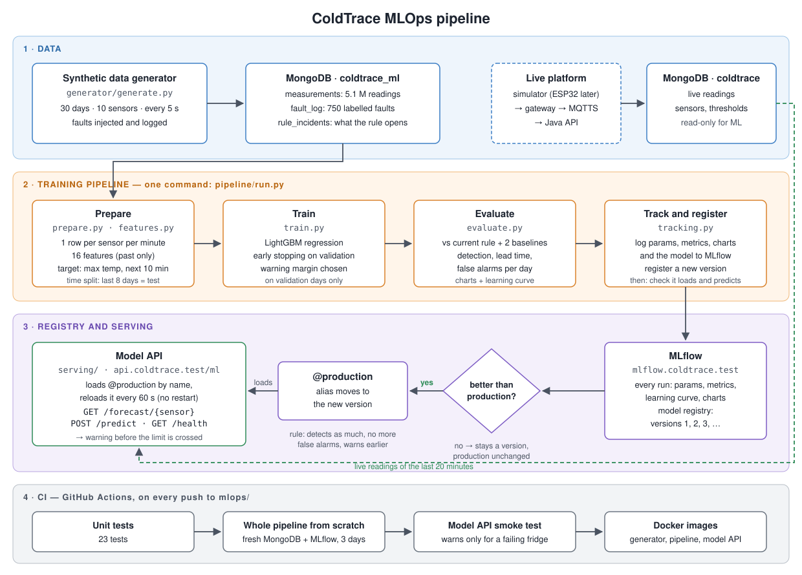
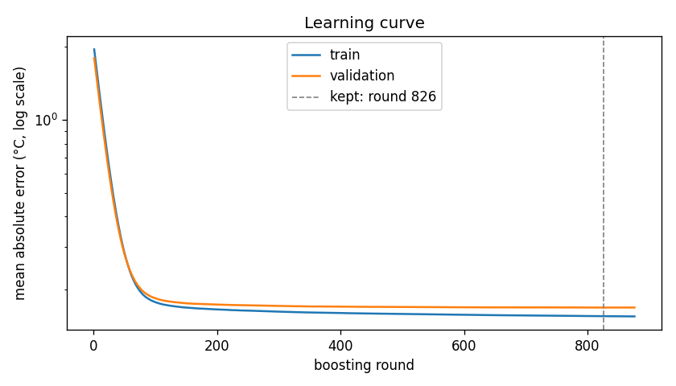
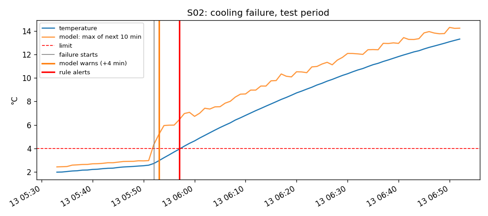

# ColdTrace MLOps: what exists and how it works

This document explains the MLOps part of ColdTrace: its goal, every part of the pipeline, the results, how to run it,
and its limits. The technical reference (commands, options, files) is [mlops/README.md](../mlops/README.md).

## Contents

1. [Goal](#1-goal)
2. [What works today](#2-what-works-today)
3. [The pipeline at a glance](#3-the-pipeline-at-a-glance)
4. [Data](#4-data)
5. [Preparation: features and target](#5-preparation-features-and-target)
6. [Training and evaluation](#6-training-and-evaluation)
7. [Tracking and model registry (MLflow)](#7-tracking-and-model-registry-mlflow)
8. [Serving: the model API](#8-serving-the-model-api)
9. [Automation and CI](#9-automation-and-ci)
10. [Infrastructure: one WildFly, one name per service](#10-infrastructure-one-wildfly-one-name-per-service)
11. [How to run it](#11-how-to-run-it)
12. [Where everything is](#12-where-everything-is)
13. [Limits and next steps](#13-limits-and-next-steps)

---

## 1. Goal

ColdTrace watches fridges and freezers. Today, the alert engine opens an incident **once a reading is already out of
range**: for a fridge, when the temperature is above 4 °C. By then the products are already warming.

The MLOps pipeline trains a model that **predicts the highest temperature of the next 10 minutes**. When the prediction
crosses the limit, it raises an **early warning, before the real alert**.

The pipeline is built so that it can be rerun at any time: when new data comes in (the real ESP32 sensors), when the
model changes, or when a teammate wants to check that everything still works.

## 2. What works today

| Part | What it does | Where to see it |
|---|---|---|
| Synthetic data | 30 days of realistic readings, 10 sensors, 750 labelled faults | Compass, database `coldtrace_ml` |
| Preparation | Per-minute rows, 16 features from the past only, target 10 minutes ahead, time split | `mlops/pipeline/prepare.py` |
| Training | LightGBM with early stopping; warning margin chosen on validation days | `mlops/pipeline/train.py` |
| Evaluation | Compared with today's rule and 2 simple baselines, on 8 days the model never saw | results table (section 6) |
| Tracking | Every run in MLflow: parameters, scores, learning curve, charts, model | https://mlflow.coldtrace.test |
| Registry | Each run registers a model version; `@production` moves only to a better model | MLflow, **Models** tab |
| Serving | An API that loads `@production` by name and reloads it when it changes | https://api.coldtrace.test/ml/docs |
| Automation | The whole chain in one command | `docker compose run --rm pipeline run.py` |
| CI | Tests, full pipeline from scratch, API check and Docker images on every push | GitHub, **Actions** tab |
| Tests | 52 automated tests (generator 7, pipeline 34, serving 11) | run by CI |
| Live monitoring | Each live forecast is saved and scored 10 min later; live error and warning accuracy per model version | http://localhost:8001/monitoring, MLflow experiment `coldtrace-monitoring` |
| Drift detection | Live inputs compared with the training data, input by input (PSI): `ok`, `watch` or `drift` | `drift` in http://localhost:8001/monitoring |
| Automatic retraining | On lasting high error, lasting drift, or age: retrains with live data, promotes only if better | `retraining` in http://localhost:8001/monitoring, MLflow tag `trigger` |

**Main result:** on the test days, the model catches **all 92 cooling failures**, **4 minutes before the current rule
(median)**, and **9.5 minutes before it on slow failures**.

## 3. The pipeline at a glance



The picture reads from top to bottom:

1. **Data.**
   - The generator writes a realistic history, with known faults, into a separate database, `coldtrace_ml`.
   - Next to it, the live platform keeps writing real readings into `coldtrace`: simulator today, ESP32 later.
2. **Training pipeline**, one command, `run.py`:
   - **prepare** turns the readings into one row per sensor per minute, with features and a target;
   - **train** fits the model;
   - **evaluate** compares it with today's rule;
   - **track and register** sends everything to MLflow.
3. **Registry and serving.**
   - MLflow keeps every run and every model version.
   - A new version gets the `@production` label only if it beats the current one.
   - The model API always serves whatever is `@production`, on the live readings from `coldtrace`.
4. **CI.** On every push, GitHub Actions replays the whole chain on a clean machine, to prove it still works.

## 4. Data

### Why synthetic data

| Problem | Consequence |
|---|---|
| The real database has 360,000 readings but only **7 temperature incidents** | Far too few examples of failures to learn from |
| The live simulator makes a fault cross the limit in **under a minute** | Nothing to predict: a real cooling failure takes 5 to 30 minutes |
| The ESP32 and Raspberry Pi are **not delivered yet** | No real data soon |

So a generator writes realistic history directly into MongoDB: 30 days in about 2 minutes. Every fault it injects is
logged, which gives an exact answer key.

### What the generator simulates

For each of the 10 simulator sensors (7 fridges, 3 freezers), one reading every 5 seconds:

- **Normal life:**
  - the compressor cycles around the setpoint: 2.5 °C for a fridge, -20.5 °C for a freezer;
  - each unit runs slightly warmer or colder than the others;
  - short door openings (10 to 60 s) happen during working hours;
  - humidity follows the door;
  - there is sensor noise, and 0.3 % of readings are lost.
- **Faults,** about one every 9 hours per sensor:

| Fault | What happens | Duration |
|---|---|---|
| Cooling failure | Temperature rises toward room temperature, 0.08 to 0.6 °C per minute at the start, then the unit is repaired and cools back down | 20 to 120 min |
| Door left open | The door stays open, the air warms | 3 to 25 min |
| Silent sensor | No readings | 2 to 40 min |
| Stuck sensor | The sensor repeats one value while the air keeps changing | 15 to 90 min |

### What it writes (database `coldtrace_ml`)

| Collection | Content |
|---|---|
| `measurements` | 5.1 million readings, same fields as the platform, plus `label`: the true state (fault, `recovery`, or normal) |
| `fault_log` | 750 faults with sensor, type, start, end and speed. This is the answer key. |
| `rule_incidents` | What today's alert rules would have opened on this data |

`label` is only used to **score** the model, never as an input.

The platform's own database (`coldtrace`) is never modified. The pipeline uses a dedicated MongoDB user that can only
read `coldtrace` and write `coldtrace_ml`.

## 5. Preparation: features and target

`prepare.py` groups the readings in MongoDB into **one row per sensor per minute**: 5.1 million readings become
430,000 rows. Minutes without readings are kept as gaps, not invented.

**Features** (what the model sees). They are computed in `features.py` and only look at the past:

| Feature | Meaning |
|---|---|
| `temp_rel` | Current temperature minus the limit (negative = safe) |
| `slope_2`, `slope_3`, `slope_5`, `slope_15` | Trend in °C per minute over the last 2, 3, 5 and 15 minutes |
| `mean_10_rel`, `min_10_rel`, `max_10_rel`, `std_10`, `rise_10` | Level, spread and rise over the last 10 minutes |
| `door_s_10`, `door_now` | Seconds the door was open in the last 10 minutes; door open now |
| `humidity`, `humidity_slope_5` | Humidity and its trend |
| `missing_10` | Minutes without readings in the last 10 |
| `is_freezer` | Profile |

**Target** (what the model predicts): the **highest temperature of the next 10 minutes**, relative to the limit.

**Split by time, never at random:**

| Part | Period | Rows | Used for |
|---|---|---|---|
| Training | first 18 days | 256,113 | fitting the model |
| Validation | next 4 days | 56,944 | early stopping and choosing the warning margin |
| Test | last 8 days | 113,783 | the final scores, seen only once |

A random split would let the model see minutes just before and after each test minute, and its scores would look
better than they really are.

## 6. Training and evaluation

### The model

**LightGBM**, a gradient-boosted tree model. It's fast (about 15 s to train), a standard choice for tabular data, and
lets you see which inputs matter. Training stops by itself when the validation error stops improving (early stopping).

**The learning curve** shows the error at each training round:



- **Both curves drop fast,** then flatten: the model learns the main patterns in about 100 rounds.
- **They stay close:** 0.156 °C on training data vs 0.169 °C on validation. So the model **does not overfit**: it works
  on days it never saw.
- **The dotted line** is the round kept by early stopping (826).

### From prediction to warning

The model warns when:

- its prediction is above **the limit + a margin**,
- **and** the door is closed.

The **margin** (0.25 °C) is chosen on the validation days: the earliest warnings that **don't raise more false alarms
than today's rule**.

The door condition is deliberate. An open door already raises its own alert at once, and the start of a short opening
looks exactly like the start of a door left open. Without this condition, 85 % of the model's false alarms happened
with the door open.

### Results on the test days

Four methods, scored on the 92 cooling failures of the test period:

| Method | Failures caught | Warns before the rule (median / mean) | False alarms per sensor per day | Forecast error |
|---|---|---|---|---|
| **Rule** (today: a reading above the limit) | 92/92 | 0 / 0 min | 0.35 | |
| Baseline "stays as warm as the last 10 min" | 90/92 | -1 / -1.2 min | 0.19 | 0.62 °C |
| Baseline "the current trend continues" | 90/92 | 1 / 0.2 min | 0.36 | 0.25 °C |
| **Model** | **92/92** | **4 / 5.0 min** | 0.44 | **0.17 °C** |

How to read it:

- **Close to the maximum:** a failure can't be seen before it starts. From the start to the rule's alert there are only
  5.2 minutes (median), and the model wins 4 of them.
- **Slow failures, where warning early matters most:** on the 18 failures that take 10+ minutes to reach the limit, the
  model warns **9.5 minutes before the rule**, out of 14 possible.
- **Better than the simple ideas:** both baselines are later and less reliable.
- **The trade-off:** slightly more false alarms than the rule (0.44 vs 0.35 per sensor per day, about one extra every
  11 days per sensor).

### One failure from the test days



- **Blue:** the temperature of fridge S02.
- **Orange curve:** the model's prediction of the maximum over the next 10 minutes.
- **Timeline:**
  - **05:52:** the cooling fails (grey line);
  - **05:53:** the model warns (orange line); the fridge is still at about 3 °C;
  - **05:57:** the rule alerts (red line), when the fridge actually crosses 4 °C.

## 7. Tracking and model registry (MLflow)

MLflow runs as a container, with its data in a Docker volume. Open it at **https://mlflow.coldtrace.test**.

**Every training run is recorded** in the experiment `coldtrace-early-warning`:

| Recorded | Examples |
|---|---|
| Parameters | learning rate, leaves, rounds kept, margin, data size, test period |
| Metrics | each method's detection rate, lead time, false alarms, forecast error |
| Learning curve | `train_l1` and `validation_l1` for each round (**Model metrics** tab) |
| Artifacts | the charts, the per-failure CSV, the metrics file, and the model itself |

Runs can be compared side by side: tick two, then click **Compare**.

**Model registry.** Each run registers a new version of the model `coldtrace-early-warning`. The label **`@production`**
moves to the new version **only if it is better than the current production model on all three**:

1. it catches at least as many failures;
2. it raises no more false alarms;
3. it warns earlier on average.

Each run's `promoted` and `promotion_reason` tags say what happened. Current state:

| Version | Run | Mean lead | False alarms/day | Result |
|---|---|---|---|---|
| 1 | default settings | 5.0 min | 0.44 | **promoted**: no production model yet |
| 2 | deliberately weaker (`--rounds 150`) | 3.3 min | 0.28 | not promoted: warns later |
| 3 | `run.py`, same data and settings | 5.0 min | 0.44 | not promoted: not better (identical) |

This protects production. A worse model, or a model that isn't clearly better, never replaces the one in use.

## 8. Serving: the model API

The `model-api` container (FastAPI) is the model in production:

- it loads the model **by name**, `models:/coldtrace-early-warning@production`, never from a file path;
- every minute it checks whether `@production` moved in MLflow, and loads the new version if so: **deploying a model
  needs no restart and no code change**;
- if MLflow is down, it keeps serving the model it already has;
- it computes the inputs with **the same `features.py` as training**, so training and live use cannot drift apart.

| Endpoint | What it does |
|---|---|
| `GET /ml/health` | Which model version is loaded, with which margin |
| `GET /ml/forecast/{sensorId}` | Reads the sensor's last 20 minutes from the platform database and predicts the next 10 |
| `POST /ml/predict` | The same prediction from readings sent in the request |

Interactive docs: **https://api.coldtrace.test/ml/docs**. Select an endpoint, click **Try it out**, then **Execute**.

**Live check with the simulator.** Thaw on fridge S03, then the service was queried every 15 s:

| Time | Temperature | Predicted max (next 10 min) | Warning |
|---|---|---|---|
| 20:46 | 2.55 °C | 2.67 °C | no |
| **20:47** | **3.15 °C** | **6.21 °C** | **yes** |
| 20:48 | 5.27 °C | 9.85 °C | yes |

The warning came while the fridge was still under 4 °C.

## 9. Automation and CI

**One command** runs the whole chain. Each stage is a separate process, and the chain stops at the first failure:

```powershell
cd mlops
docker compose run --rm pipeline run.py              # prepare → train → register/promote → check
docker compose run --rm pipeline run.py --generate   # regenerate the 30 days of data first
```

The last stage, **check**, loads `@production` by name and makes sure it predicts. The run takes about 1 minute, or 3
with `--generate`.

**GitHub Actions** ([.github/workflows/mlops.yml](../.github/workflows/mlops.yml)) runs on every push that touches
`mlops/`:

| Job | What it proves |
|---|---|
| Unit tests | the 52 tests pass |
| Whole pipeline from scratch | on a clean machine, with an empty MongoDB and MLflow: generate 3 days, prepare, train, register, check. Then the model API starts and must warn for a failing fridge and stay quiet for a stable one. The charts and scores are kept with the run (`mlops-report`). |
| Docker images | the generator, pipeline and model API images build |

The CI model is trained on 3 days only, so its scores are lower. CI checks that the **pipeline works**; model quality is
checked by the 30-day run and by the promotion rule.

## 10. Infrastructure: one WildFly, one name per service

Each service has its own name instead of `localhost:port`, as in a real deployment, all served over HTTPS by **one
WildFly** ([middleware/wildfly](../middleware/wildfly/README.md)):

| Address | Service |
|---|---|
| https://coldtrace.test | the monitor (front-office) |
| https://api.coldtrace.test | the REST API, and the model under `/ml/` |
| https://mlflow.coldtrace.test | MLflow |
| https://iam.coldtrace.test | the login server (users and roles; the API and the monitor need a login, the model API and MLflow do not yet) |

It has two parts:

- **The hosts file** (`C:\Windows\System32\drivers\etc\hosts`) points these names to the PC itself (127.0.0.1).
- **The WildFly** gives each name a virtual host, with the course's scripts (`default-host.cli`, `add-host.cli`,
  `add-api.cli`). The back-office is at `admin.coldtrace.test`. The two Python services of the MLOps part (the model
  API and MLflow) are not WildFly applications: WildFly forwards `api.coldtrace.test/ml/` and `mlflow.coldtrace.test`
  to their containers (reverse proxy).

## 11. How to run it

Once per PC:
- add the names to the hosts file and trust the development CA ([middleware/wildfly/README.md](../middleware/wildfly/README.md)), or simply run `.\start`;
- create `mlops/.env` and the MongoDB user ([mlops/README.md](../mlops/README.md)).

Then:

```powershell
cd C:\Users\MSI\Desktop\ColdTrace-cot\gateway-iot;  docker compose up -d          # the platform, with the WildFly
cd ..\mlops;                                       docker compose up -d mlflow model-api
docker compose run --rm pipeline run.py --generate                                # data + training
```

Check:
- https://mlflow.coldtrace.test shows the runs;
- https://api.coldtrace.test/ml/health answers `"status": "ok"`.

## 12. Where everything is

| Path | Content |
|---|---|
| `mlops/generator/` | Synthetic data generator and its tests |
| `mlops/pipeline/` | `prepare.py`, `features.py`, `train.py`, `evaluate.py`, `tracking.py`, `run.py`, tests |
| `mlops/serving/` | The model API and its tests |
| `mlops/ci/` | The model API check used by CI |
| `mlops/docker-compose.yml` | MLflow, model API, pipeline, generator, MongoDB user setup |
| `mlops/data/` | Generated files: datasets, model, charts. Ignored by git, recreated by the pipeline. |
| `middleware/wildfly/` | The WildFly that serves every name (it also forwards to MLflow and the model API) |
| `.github/workflows/mlops.yml` | The CI workflow |
| `docs/MLOPS.md`, `docs/img/` | This document and its pictures |

## 13. Limits and next steps

**Limits:**

- **Simulated data:** the model learned the generator's physics. On real ESP32 data it must be retrained: same
  pipeline, new data.
- **A failure can't be predicted before it starts:** the gain is a few minutes on fast failures and about 10 on slow
  ones.
- **False alarms:** slightly more than today's rule (0.44 vs 0.35 per sensor per day).
- **Local MLflow:** it runs on one PC. In a real deployment it would be a shared server.
- **The simulator is too fast and too regular:** its Thaw crosses the limit in about 40 seconds, faster than a
  per-minute model can warn, and its inputs are much flatter than the training data, so drift is permanent. On a
  realistic slow rise, the early warning opened at 3.0 °C, about 5 minutes before the limit.

**Done since this document was first written** (details in [mlops/README.md](../mlops/README.md) and
[middleware/api/README.md](../middleware/api/README.md)):

1. **Warnings in the monitor:** the Java API calls `/ml/forecast` every 30 s and opens an `early_warning` incident,
   shown in yellow, before the real alert.
2. **Monitoring:** each live prediction is saved and compared 10 minutes later with what really happened (live error,
   precision, recall per model version), and the live inputs are checked for drift (PSI).
3. **Automatic retraining:** on lasting error, lasting drift, or age, the pipeline retrains with recent live readings.
   The new version replaces production only if it is better.

**Next steps:**

1. **Real data:** when the ESP32 sensors arrive, the same monitoring shows at once whether the model fits, and
   retraining uses their readings.
2. **A more realistic simulator** (slower failures, door openings, noise), so the demo shows early warnings and no
   permanent drift.
3. **LLMOps:** an assistant that writes incident reports, with versioned prompts and test cases.
